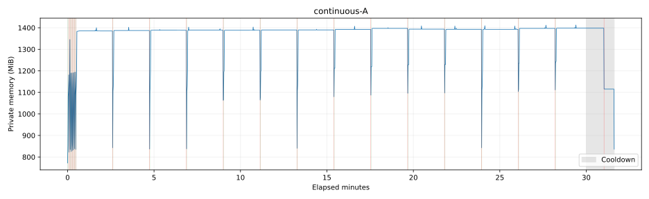
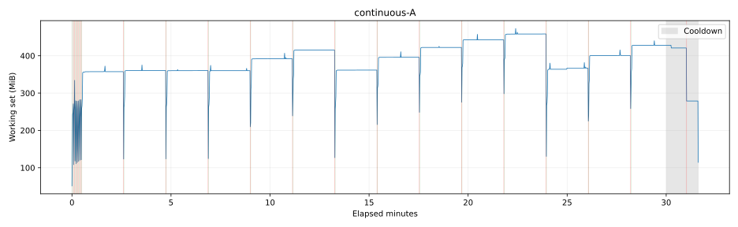

# OCR 内存控制第二轮验收

日期：2026-11-02，Asia/Hong_Kong。分支：`fix/upstream/openvino-ocr-memory-leak`；HEAD：`c6e4cfba65c3c359942d9770e51f2d44d9ff9860`。基于第一轮未提交实现继续开发，没有重置、提交、推送或替换日常安装版。

第一轮事实保留在 [原报告](ocr-memory-validation.md)。本轮证据目录为 `logs/ocr-memory/followup-20261102-172923/`，以下数字只归属于注明的配置、阶段和观察窗口。

## F0：现场、环境与入口

开始时记录 22 个任务相关文件，完整文件副本在 `start-files.zip`，内容哈希、分支、HEAD、状态在 `start-source.json`，跟踪文件差异在 `start-working.diff` / `start-staged.diff`。这些文件在本轮编辑前生成。历史 HEAD 仅作引用，没有覆盖未提交工作。

开发环境沿用本地 `.venv`：Python 3.12.15、ok-script 2.0.22+okww.ocr1、OnnxOCR 0.0.22+okww.ocr1、OpenVINO 2026.3.0、PySide6/Qt 6.12.0。CPU、RAM、模块路径、原始/补丁 wheel 哈希与模型哈希见 `environment-start.json`。原始 wheel 和两份后端补丁继续复用，没有重新设计管理系统。实际包路径与版本还在每次运行中记录。

纯 CPU 协议固定 `use_npu=false`、batch=6、requests=1、空编译配置、AVX2；自然协议不加载 YOLO、不连接截图/MCP、不发送通知。游戏/GUI 的实际捕获、分辨率、设备和通知条件单独记录。宿主游戏和用户 GUI 未关闭；`host-background.json` 与 `game-privileges.json` 记录可见进程及权限。游戏在连续观察开始后不久重启，属于初始阶段的后台干扰，未删除该段数据。

| 已有入口 | 开始时核对的能力 | 本轮补充 |
| --- | --- | --- |
| `benchmark_ocr.py` | 有界直接后端回放、手动周期释放、采样、汇总和一致性比较 | 关键文字/位置期望；非 Git 产物环境记录 |
| `benchmark_ocr_runtime.py` | 执行器/GUI、通知、legacy | 真实执行器的 calls/age/continuous 协议；独立服务和全程调用记录 |
| `benchmark_farm_echo.py` | MCP 薄包装，回血后委托注册 FarmEchoTask | 实际捕获、队伍、拾取断言与结果记录 |
| `benchmark_yolo.py` | 显式加载/释放/重载 | 复用，不重新实施 YOLO 优化 |
| `build_ocr_wheels.py` | 原 wheel 校验、严格补丁、确定性 wheel | 带相对依赖和哈希清单的本地验证更新包 |
| `ocr_benchmark_config.py` | 基于完整应用配置覆盖 OCR 实验字段 | 保留原入口；新对照由完整 OCR 配置生成 |

配置契约仍区分：`replay --config` 接收含 `params` 的对象；runtime、GUI 接收完整 OCR 对象。A/B 配置保留 `lib`、`auto_simplify` 等原字段，仅按协议覆盖实验字段。命令均以脚本真实参数为准。

## F1：真实自然轮换

调用链为 `config.py:install_ocr_idle_release` → `TaskExecutor.ocr_lib` → 稳定 `ManagedOCR` → `_acquire/_call/_finish_call` → 原执行器 `_create_ocr_lib`。识别在真实 `ExecutorJob` 上执行，所有请求一直使用原代理。没有写入调用计数、模型时间或模型字段，没有主动释放。

监测器由 prepare/首次识别启动，一条弱引用线程贯穿执行器生命周期；退出后 join 并检查停止。回收先关闭新调用入场，活动调用归零后排空原生队列，锁外清理，再恢复入场。新增标量生命周期日志保存重置前的代次、计数、年龄、原因、活动数、加载/排空/释放耗时，不持有模型或数组。prepare 不计入调用预算；原有语义是每个结束的识别调用计数，异常调用也计数。本轮真实协议未出现识别异常。

| 专项 | 直接证据 | 结果 |
| --- | --- | --- |
| 128 次调用预算 | `call-limit.jsonl`：257 次、0.2 秒节奏；第 1/2 代各 128 次，年龄约 25.469/25.234 秒，原因均为 call limit，释放时活动数 0；第 257 次由原代理建立第 3 代并识别 500 | 通过 |
| 300 秒年龄预算 | `model-age.jsonl`：0、10…290 秒低频调用；301 秒只读快照；307 秒识别结束以 model age 回收，随后原代理重载 | 通过 |
| 竞争预算 | 两个专项没有被 idle 或 process growth 提前回收；仍使用 60/128/300/512 默认保护 | 通过 |

年龄回收发生在后续识别结束边界，不是独立的 300 秒定时器。低频专项不作为高频内存收敛证据。进程增长保护的真实触发另见 F2；模拟取消、排空失败等仍由回归测试覆盖。

## F2：连续 30 分钟、释放尾部与旧异常

补丁兼容 A 从新进程运行四个原始 ROI，固定顺序，每秒一次，1800 次识别；实际作业持续 1800.03 秒。调用上限 10000、私有内存停止线 4096 MiB，观察没有触线。调度滞后 P95 约 15 ms、最大 31 ms。未在每 40 次释放，未临时降频或暂停负载以制造低点。

共 21 代：最初 7 代各 4 次后由 private memory growth 回收；第 8—20 代各 128 次由 call limit 回收；最后一代 108 次，停止作业后自然 idle 回收。所有释放事件的活动数均为 0。整段采样峰值私有内存 1412.9 MiB，工作集 473.1 MiB；热调用 P50/P95 约 24.58/56.48 ms。代次、计数、耗时和可比较阶段指标全部保存在 `continuous-A-summary/` 的 CSV/JSON，原始记录为 `continuous-A.jsonl`。

第二半段第 15—21 代在相同模型年龄 10—100 秒阶段的私有内存中位数分别为 1392.20、1397.09、1393.57、1393.01、1392.92、1396.99、1397.98 MiB。首末差 5.79 MiB，线性坡度约 +0.276 MiB/分钟，存在明显回落，不能称为逐代单调增长。**热阶段在该观察窗口内有小幅变化，尚不能确认长期收敛**。未做原版依赖的 30 分钟同条件组，因此不将此结果归因于后端补丁改善或恶化。

释放边界另有更大的阶段差异：第 8—10 代 t=0 约 836.8—842.8 MiB；第 11/12 代约 1063.1/1064.1 MiB，第 13 代又回到 840.5 MiB。后续也有第 18 代 842.7 MiB 与第 19/20 代 1103.9/1111.4 MiB 的交替，不能只取较低分支宣称稳定。

停止提交后保留 95 秒独立冷却。第 21 代释放后的外部 t=0/2/10/30 秒采样均为未加载、活动数 0，私有内存均约 1115.3 MiB；没有加入额外 GC、trim 或强制释放。这证明本次较高残留并非都能靠把两秒窗口延长到 30 秒消失，但仍不能确定其分配归属。综合判定：阶段性抬升已观察，**持续趋势及长期收敛仍未决**；不能把热阶段的 5.79 MiB 小变化用作释放后驻留已稳定的证明。

释放边界由标量日志通知独立采样线程；84 个尾部点中，24 点处于纯卸载状态，60 点已加载下一代。持续负载中 t=2/10/30 秒通常属于下一代，报告不再称这些点为“卸载后的低点”。实际采样偏差及模型创建时间保存在 `release-tails.csv`。





绿线为创建、红线为释放完成，灰区为停止负载后的冷却，包含等待自然闲置和释放后的观察。最新逐代和尾部表位于 `continuous-A-reviewed/`。卸载状态下当前模型年龄为 null；最近一次创建时间从同代的不可变 created 事件关联，未把预算重置时间误当新模型创建。

候选 B 没有另跑 30 分钟组。本协议相邻 OCR 间隔小于 60 秒，热路径的模型工厂、预算和回收实现相同，因此只复用 A 的持续热路径证据；B 的启动、普通任务及预定闲置需看独立验证，不能把未运行的 B 长测写为实测，也不能声称这里测到了任务间隔收益。

旧异常窗口摘录在 `prior-anomaly-window.json`：第 9 代 37.078 秒完成释放，37.078/37.422/38.438 秒均标记 unloaded，私有内存 1030.945 MiB；第 10 代在 39.297 秒创建，41.094 秒释放后约 832.754 MiB。可排除“该低点实际已加载下一代”的解释；旧记录缺少更长尾部和原生分配归属，原因仍未决。保留原异常值，不用新节奏数据覆盖旧记录。

## F3：对应 batch=6 策略与 GUI

首个成对尝试保留在 `pairs/01-A/`：隔离服务漏注册 `MouseResetTask`，正式任务未进入战斗；SDK 响应解析也把运行状态的 `result=null` 当作外层结果。这两处验证入口问题已修复，失败尝试不纳入性能统计。

A 为补丁兼容默认策略，B 只改 preload=false/ocr_idle，两组 batch=6、requests=1、空编译配置、60/128/300/512 相同。MCP 任务固定请求 CPU（use_npu=false），实际 CPU；1920×1080 WGC、PostMessage、Hiyuki/Lucilla/Verina、首个强敌天傀劫煞，每次先回血再刷一次。恢复和后续预热均不纳入 FarmEchoTask.run 正式计时。每次新进程，顺序 A/B、B/A、A/B，任务后观察 95 秒。没有领取耗体力奖励。

第一组自然加载场景 `pairs-v2/` 的六轮均完成击杀并拾取 1 个声骸：

| 轮次 | 任务秒数 | 任务峰值私有 MiB | 峰值工作集 MiB | OCR 调用 | 热 OCR P95 ms |
| --- | ---: | ---: | ---: | ---: | ---: |
| 01-A | 65.075 | 1277.5 | 413.2 | 62 | 28.626 |
| 02-B | 68.230 | 1244.8 | 403.9 | 65 | 28.410 |
| 03-B | 75.224 | 1292.7 | 430.4 | 59 | 34.039 |
| 04-A | 70.847 | 1393.0 | 551.4 | 44 | 30.869 |
| 05-A | 68.986 | 1225.1 | 383.5 | 68 | 31.196 |
| 06-B | 79.251 | 1292.3 | 431.9 | 45 | 40.416 |

任务 B/A 比分别为 1.0485、1.0618、1.1488；热 OCR P95 比为 0.9925、1.1027、1.2956。任务中位数 A/B 为 68.986/75.224 秒（B +9.04%）。该组两对超过 5% 任务预算及 10% 热 P95 预算，**未通过预算**；OCR 输入组成和调用数量不同，不据聚合 P95 推断纯推理变快或变慢。

该组起始 YOLO 均未加载，但 04-A 的自然任务分支实际加载了 YOLO，其他轮没有加载；它的驻留和峰值不能归因于 OCR 策略。原六轮完整保留，不排除 04-A 来选最好数据。为补齐严格可比性，薄包装新增通过现有 Globals.yolo_detect 统一预热的入口，并记录准备耗时和初始设备；不改变产品懒加载或自动释放策略。用户明确授权另做三对全程已加载的严格组，结果单列于 `pairs-controlled/`。

严格组每轮计时前确认 YOLO 已加载且实际 CPU，计时期间及任务后观察均保持加载；所有组都不主动释放。六轮同样各拾取 1 个声骸：

| 轮次 | 任务秒数 | 任务峰值私有 MiB | 峰值工作集 MiB | OCR 调用 | 热 OCR P95 ms |
| --- | ---: | ---: | ---: | ---: | ---: |
| 01-A | 65.353 | 1391.9 | 544.6 | 37 | 29.085 |
| 02-B | 73.074 | 1511.6 | 608.8 | 36 | 33.359 |
| 03-B | 75.204 | 1428.1 | 564.8 | 68 | 25.771 |
| 04-A | 70.320 | 1413.0 | 562.3 | 51 | 33.108 |
| 05-A | 72.323 | 1457.7 | 584.1 | 37 | 31.293 |
| 06-B | 73.467 | 1461.9 | 580.7 | 71 | 28.491 |

任务 B/A 比为 1.1181、1.0695、1.0158，仍有两对超 5%；热 P95 比为 1.1470、0.7784、0.9104，一对超 10%。任务中位数 A/B 为 70.320/73.467 秒（+4.48%），该中位数在预算内，但不能覆盖配对波动。任务峰值私有内存中位数 A/B 为 1413.0/1461.9 MiB，未观察到稳定任务峰值节省。

两种 YOLO 条件分别汇总，不选最好组来宣布候选通过。结论为：**功能通过，性能尚未稳定满足预算，候选不替换兼容默认**。三对仅支持有限样本；保留各次输入形状、结果和调用分布，不能把热 P95 中位数下降归因于策略让推理变快。两组完整样本、逐次结果、冷构造及任务后状态分别在 `pairs-v2-summary/`、`pairs-controlled-summary/`，初始化与首次后端识别耗时分别记录，未用相加估计值冒充完整调用实测。

GUI 使用 B 的生产 use_npu=true，实际 CPU，并包含构造自检。`gui-dev/` 通过真实 Qt TaskCard.start_button.click 进入原 FarmEchoTask，正常击杀并拾取 1 个声骸。有限 OCR 探针的真实卡验证了一次暂停/恢复完成和一次停止取消；暂停稳定后的调用计数未推进。约 60.3 秒 OCR 闲置后释放，原 NotificationPPOCR 重载到第 2 代并识别 500；退出后监测器停止，后续调用被拒绝且代次不变。等待释放期间调度器未暂停、仍有一个启用的触发任务，executor_idle_blocked=true，说明此处确实覆盖了 OCR 自身闲置策略。任务阶段 Qt 心跳最大间隔 250 ms；初始窗口构造的首个心跳间隔 6.406 秒，单独记录，不能称为启动全程无阻塞。

补充“在真实 FarmEchoTask 本身暂停/停止”的启动被 Windows UAC 用户取消；该可选入口 `--farm-controls` 仅完成语法核对，本轮**未验证**，没有用探针结果冒充实际刷声骸卡的控制结果。首次 GUI JSONL 的通用环境模板误记 capture_backend=file replay/notifications=false；实际 WGC/1920×1080 由 `gui-dev-capture-log.txt`、任务与显式通知事件核实。原日志不改写，交付代码及后续产物 GUI 记录已修正。

## F4：输入、正确性与缓存边界

新增输入 `ocr_followup_inputs.json` 保留原四图并更正棋盘底部 500 的标签，增加真实剧情长中文、密集声骸属性及混合聊天文本，共七个图像/ROI。新旧标签通过同图 SHA 和相同 ROI 对应，旧日志不重写。实际 rec 宽度为 320/352/801/1797，batch 为 1/2/4/5/6；det 包括 320×640、64×512、192×864、416×960、448×864、960×704、448×960。rec_batch_num=6 未被误作每次实际 batch=6。

九个固定关键文字/位置/空结果期望中，八个通过，一个严格文字失败：警告图标被识别成前缀 A，输出为 A会话已建立。首轮 `shapes-first.jsonl` 的失败退出保留，未把期望改成包含匹配以凑通过。后续 20 轮重复此结果，只是七个样本重复，不是 140 个不同样本。原版依赖在独立环境中的 140 次同序列与补丁文字/框一致（2 像素容差），因此未发现该项属于补丁回归，但严格关键结果仍未通过，全文 OCR 准确率也没有做完整标注。

微基准直接使用同一模型 140 次，不属于 F1 生命周期验收。固定数字 ROI 与变化输入均新进程、有界 300 秒/4096 MiB、无中途主动释放，完成后仅按已有 finite replay 方式卸载一次。变化输入带来更高驻留，因此按预定条件补 cache=200/0，保持 batch、顺序与其他选项相同：

| 变化输入配置 | 峰值私有 MiB | 8 秒后加载状态中位数 MiB | 热 P95 ms |
| --- | ---: | ---: | ---: |
| cache 默认 | 1981.8 | 1925.9 | 193.31 |
| 请求 cache=200 | 2002.4 | 1934.8 | 197.72 |
| 请求 cache=0 | 1952.6 | 1899.0 | 194.88 |

固定 ROI 加载阶段约 1074.5—1080.7 MiB；变化输入在首次触达大形状后约 1915.4—1940.9 MiB，未呈现后半段持续增加。cache=0 的单次约 1.5% 峰值变化小于单次形状切换的波动，未形成值得推荐的候选，停止扩展，没有做参数全排列或宣称最优。两项内部属性编译接受但不能回读实际值，不能把“200”当 MiB 或精确 shape 数。

旧的“缓存调参收益不足”仅限原四个 ROI；本轮拓宽了输入，仍未获得可靠的全局推荐依据。不能由此外推所有文本/形状都没有缓存收益。

## F5：干净依赖、产物和回滚

在新的 `build/ocr-installed-validation-v2/` 解压本地验证更新包，实际执行包内 install-validation.ps1：核对成员哈希、新建 .runtime、通过相对 requirements 安装包内两个补丁 wheel，并通过 pip check。没有复制日常 site-packages，没有修改日常安装目录。运行路径、wheel SHA、逐步命令/退出状态在 `artifact-stage-v2.json`、`matrix/steps.jsonl`、`matrix/wheel-hashes.json`。

依赖矩阵通过同一个全新环境、受控 wheel 安装与每项新进程执行；切换时实际卸载旧包，检查导入版本/路径，并用真实 OCR 验证行为。保持生产 use_npu=true，实际回退 CPU，构造自检单列，不能当 NPU 已验证。各正向项真实等待默认 60 秒闲置，原通知代理重载到第 2 代：

| 组合/动作 | 结果 |
| --- | --- |
| 完整补丁 A、B | 预热/不预热符合配置，500 识别、闲置释放、原代理重载通过 |
| B 恢复兼容配置 | 重新预热、识别和回收通过，不回退源码 |
| 原版 ok-script 2.0.22 + OnnxOCR 0.0.22，A/B | 兼容识别与应用侧懒加载均通过；未误称懒加载一定需要工厂补丁 |
| 原版工厂请求 batch=1 | 初始化明确拒绝缺少参数透传能力 |
| 补丁工厂 + 原版 OnnxOCR 请求非空编译配置 | 初始化明确拒绝缺少编译配置入口 |
| 上述部分组合的拼错参数 rec_batch_nmu | 初始化明确报未知参数；修复旧后端任意 kwargs 被静默忽略的缺口 |
| 恢复补丁依赖、再次恢复原依赖 | 各自真实导入内容、预热、识别、闲置回收与重载通过 |
| 最终恢复补丁依赖 | pip check 通过，保存 freeze；日常环境不受影响 |

更新包沿用 deploy.txt 的源码/资源布局，包含可核验的相对 wheel 接入和独立启动设置。它是**本地源码/更新验证包**，不是 PyAppify EXE 安装器。正式工作流仍使用 PyAppify action、签名和发布，本轮未执行；正式安装器/日常安装版替换**未验证且未进行**。

独立安装环境使用 Qt 6.11.1，开发环境为 6.12.0；OpenVINO/模型/AVX2 相同，其他依赖差异在 freeze 中保留。`gui-artifact/` 用普通用户权限运行包内真实 GUI 任务卡的文件 OCR 探针，不发送游戏输入、不提权：完成、暂停/恢复、停止、默认 60 秒闲置、通知重载与退出拒绝新建均通过。该结果验证包内 GUI/OCR 入口，不冒充安装产物的真实游戏任务验收。

包内四个关键已安装模块逐字节匹配补丁 wheel，见 `artifact-installed-patch-check.json`。产物的 config、ManagedOCR、Globals 和 ROI 任务文件与最终工作区一致，见 `artifact-product-match.json`；后续完善的汇总/复测编排脚本以工作区版本为准。第一次安装包及最终增加生产设备选项的 v2 包分别保留，没有覆盖先前构建。

## F6：检查、证据和复现

最终受影响与必要回归共 99 项：OcrMemory 52、Backend 8、Benchmark 4、Config 5、ChangeEchoROI 1（含三个分辨率）、WaitLogin 4、TacetElimination 21、YoloMemory 4。它们包含模拟并发/取消和真实 CPU 推理，不能当作真实 NPU 验证。临时目录 ACL 错误与新夹具缺少 phase 的失败日志均保留；改用工作区临时目录、补齐夹具后相关检查通过。没有增加同构测试来夸大样本数。

源码未配置 Python typecheck/lint；执行语法编译、pip check、git diff --check、mkdocs build --strict。补丁 wheel 再次构建，比较固定来源及内容哈希；没有运行发布、签名或安装版覆盖。

最小审阅包 `review-evidence.zip` 包含第二轮差异、开始/最终源码指纹、环境/协议/运行清单、汇总、完整自然轮换/连续 JSONL、任务/GUI 关键数值记录、代表性结果图和复现脚本。完整日志和截图继续保留在上述证据目录，连接文件与服务令牌不进入审阅包。`round2.diff` 相对本轮开始的文件快照，`head-working.diff` 则含上一轮已存在的跟踪文件修改；二者不混淆。

本轮自然协议及第一组三对的性能证据产生于参数拼写预检补齐前；默认参数不进入新预检分支，模型、预算和热路径未改。最终代码再经过 99 项检查、GUI 和干净依赖矩阵；各阶段源码指纹分别保留，不把历史 HEAD 视为未提交实现的唯一指纹。

在项目根目录使用本地环境，输出始终选择新文件/新目录：

```powershell
$env:ONEDNN_MAX_CPU_ISA = 'AVX2'
.\.venv\Scripts\python.exe scripts/benchmark_ocr_runtime.py --protocol calls --calls 257 --period .2 --seconds 100 --output logs/ocr-memory/new-calls.jsonl
.\.venv\Scripts\python.exe scripts/benchmark_ocr_runtime.py --protocol age --seconds 330 --output logs/ocr-memory/new-age.jsonl
.\.venv\Scripts\python.exe scripts/benchmark_ocr_runtime.py --protocol continuous --manifest scripts/ocr_real_inputs.json --seconds 1800 --period 1 --cooldown 95 --output logs/ocr-memory/new-continuous.jsonl
.\.venv\Scripts\python.exe scripts/summarize_ocr_lifecycle.py logs/ocr-memory/new-continuous.jsonl --output logs/ocr-memory/new-summary --plot
.\.venv\Scripts\python.exe scripts/benchmark_ocr_pairs.py --output logs/ocr-memory/new-pairs --timeout 600 --post-task 95 --yolo-state loaded
.\.venv\Scripts\python.exe scripts/benchmark_ocr.py replay --manifest scripts/ocr_followup_inputs.json --repeats 20 --cycles 1 --settle 2 --max-seconds 300 --output logs/ocr-memory/new-shapes.jsonl
```

绘图需要可选开发工具 Matplotlib（本机 3.11.2），不进入生产依赖。纯生命周期协议固定 use_npu=false；上述 GUI/矩阵另行使用生产请求 true。游戏命令在与游戏匹配权限的会话中执行，保留原 GUI，启动前先核实执行权；不要并行跑性能回放、GUI 和游戏。

构建/安装和完整矩阵命令（新解压目录，关闭使用该测试环境的自有进程后切换 wheel）：

```powershell
.\.venv\Scripts\python.exe scripts/build_ocr_wheels.py --bundle build/new-ocr-validation.zip
# 解压到新的测试目录后执行包内 install-validation.ps1 -Python <绝对 Python 3.12 路径>
.\.venv\Scripts\python.exe scripts/run_ocr_dependency_matrix.py --app build/ocr-installed-validation-v2 --output logs/ocr-memory/new-matrix
```

完整参数化命令也保存于证据包的 `reproduce.ps1`，按 lifecycle/shapes/pairs/build/matrix/gui/checks 分阶段串行执行。依赖安装与回退细节见仓库根目录的 `patches/ocr/README.md`。

| 验收项 | 最终状态 |
| --- | --- |
| F0 现场保留与指纹 | 通过；原 22 文件完整快照仍在，未丢弃用户改动 |
| F1 调用/年龄轮换 | 通过；两次 128、一回真实 300 秒年龄边界，原代理恢复 |
| F2 30 分钟和冷却协议 | 通过执行；抬升/残留归属及长期收敛未决 |
| F3 完整任务功能 | 两种 YOLO 条件共 12 轮通过；每轮拾取 1 个声骸 |
| F3 候选性能 | 未能稳定通过；不推荐替换兼容默认 |
| F3 GUI | 正常刷声骸 Start/完成及 OCR 探针控制通过；真实刷声骸卡暂停/取消未验证（UAC 取消） |
| F4 输入与一致性 | 形状覆盖、140 次原版一致性通过；一个关键文字精确期望未通过 |
| F4 缓存推荐 | 没有形成推荐依据；保持空编译配置 |
| F5 干净组合、更新验证包及回滚 | 所列 CPU/fallback 组合和包内 GUI 探针通过 |
| F5 正式安装器、真实 NPU | 未验证；未发布、未替换日常安装版 |

## 默认配置、边界与交付

兼容默认继续为 preload=true、executor_idle、60 秒/128 次/300 秒/512 MiB、batch=6、requests=1、空编译配置。B 只改变 preload=false 与 ocr_idle。batch=1、cache=200/0、YOLO 自动卸载均未改为默认。

新增能力检查在初始化阶段拒绝“工厂已透传但 OnnxOCR 缺少编译配置入口”的组合，错误指出所需补丁及构建命令；应用侧懒加载与依赖工厂、后端编译配置能力分别处理。依赖恢复独立于源码回滚，不使用 git reset。

剩余缓慢抬升和释放后驻留尚未定位到 OCR native；没有据此实现尺寸分桶、trim 或产品级 OCR 工作进程。真实 NPU、任意时长稳定性与正式 PyAppify 安装器仍需各自的直接证据。启动节省、batch 变化与 YOLO 释放量没有相加为产品总收益。
