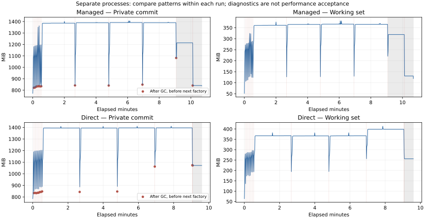

# OCR 内存第三轮验收：驻留归因与部署接入

日期：2026-11-02，Asia/Hong_Kong。分支 `fix/upstream/openvino-ocr-memory-leak`，HEAD `c6e4cfba65c3c359942d9770e51f2d44d9ff9860`。本轮未提交、推送、发布或替换日常安装版，A 继续默认，B 保留可选。

证据目录：`logs/ocr-memory/round3-20261102-211933/`。历史事实见 [第二轮报告](ocr-memory-followup-validation.md)；原报告和原始日志未改写。以下区分旧证据复核、新诊断、推测和未验证项目。

## N0：现场与证据边界

修改前保存 36 个相关文件的完整快照、SHA-256、Git 状态和差异，见 `start-files.zip`、`start-source.json`、`start-working.diff`、`start-staged.diff`。其中第二轮最终清单的 33 个文件全部匹配。没有 reset、stash 或覆盖已有改动；本轮增量单独交付为 `round3.diff`，相对 HEAD 的跟踪文件总差异另存。

复用第二轮已记录的两次自然 128 次调用轮换、一次真实 300 秒年龄轮换、两套各三对任务、依赖矩阵及 GUI 已通过入口，不再整套重做。99 项是第二轮历史检查数量，本轮实际重跑数量见 N5。

发现一个历史可追溯性缺口：第二轮长测记录了当时 `src/ocr_memory.py` 的哈希 `e7a2384cec18bcb658b7e3806296e0525b3910aa69a38ac511707a62a6ff1ef6`，但开始/最终快照均非该版本。根据差异移除后加的预检所得到的候选源码仍不匹配该哈希。因此，“性能采集后只增加参数预检、热路径完全未变”**未能以完整阶段源码独立证实**，不能由首尾差异直接补成事实。它不抹去日志中的计数、结果和状态，但限制对历史代码变化的归因。本轮新诊断的源码字节已与运行指纹匹配并另存 `diagnostic-sources.zip`。

开发环境继续使用项目 `.venv`，Python 3.12.15、OpenVINO 2026.3.0、Qt 6.12.0、AVX2、两个 `+okww.ocr1` wheel；模型和 wheel 哈希与第二轮相同。新诊断各自从新进程开始，纯 CPU、batch=6、requests=1、空编译配置，不加载 YOLO、不连接 MCP、不截图或发送游戏输入。用户原 GUI、游戏未关闭，后台未冻结。部署冒烟另用第二轮独立 `.runtime`，Qt 6.11.1；CPU fallback 与真实 NPU 分开记录。

## N1：先复核历史记录

`final-audit-reviewed/prior-first-eight.csv` 按 run_id、代次、调用序号和时间关联前八代：原前七代各 4 次以 private memory growth 回收，第八代 128 次以 call limit 回收，释放活动数均为 0。旧日志缺少实际 baseline、设置时刻、工厂前后内存、判定读取值及同时满足的预算条件；表中这些字段为缺失。邻近创建采样保留实际时间偏差，仅为邻近值，**不当作 baseline**。自然长测也没有 native shape 事件，不能用第二轮其他回放的 shape 冒充该次实际记录。

`prior-release-tails.csv` 保留全部 84 点及 loaded、active、当前代次、创建时间和延迟。约 840 与 1060–1115 MiB 的历史差异确实存在，但加载下一代的 60 点仍排除在纯卸载比较之外。旧第九轮的 1030.945 MiB 仍是卸载状态，随后第十轮释放约 832.754 MiB；长尾和分配归属缺失，原因仍未决。游戏重启只作为后台条件，不解释为目标进程私有分配的来源。

`release_complete` 的代码含义是：活动调用已退出、队列 wait_all 完成、管理器字段与局部模型引用清空、原有 gc.collect 已执行。它不证明所有原生分配归还。

### 配对统计口径

两组分别重算，不剔除自然组唯一加载 YOLO 的 04-A，不混合两种状态：

| 历史组 | 三对 B/A − 1 | 配对差异中位数 | 两组各自中位数之比 − 1 |
| --- | --- | ---: | ---: |
| 自然 YOLO 加载 | +4.8487%、+6.1773%、+14.8806% | +6.1773% | +9.0430% |
| YOLO 全程已加载 | +11.8135%、+6.9452%、+1.5813% | +6.9452% | +4.4753% |

原协议指定 5% 任务、10% 热推理预算，但没有预先指定主汇总统计量，也没有“每一对必须过线”的规则。上述新增统计是**事后探索分析**；不能选择 +4.4753% 追溯宣布通过，也不能事后新增逐对全过的规则。存在超预算样本，整体候选性能尚未建立通过结论，B 不切为默认。

`prior-pair-shape-timings.csv` 按 FarmEchoTask.ocr、输入尺寸、native shape/batch 序列及冷/热分组。旧数据没有更细的源代码调用行、调用栈或逐帧哈希，不能证明内容相同。任务内创建/重载与冷调用已分开，不把构造耗时与 backend 时间相加冒充完整调用，也不据聚合 P95 给变慢归因。未重跑两套矩阵。

## N2：有界诊断与归因

默认关闭的 `OKWW_OCR_DIAGNOSTICS` 记录真实 baseline 赋值、工厂前后、每代前四次调用、预算判断、排空、清引用和清理边界。观察者队列上限 4096，弱引用注册表上限 512；回调只携带代次、种类和标量 ID，不反向解引用模型。记录丢失会使诊断报不完整。没有全程对象扫描或重型 Python 分配追踪。

运行前固定 600 秒/600 次/4096 MiB、1 秒节奏、最长 95 秒冷却、外层 720 秒超时。捕获规则为：见到实际 growth 判断，且纯卸载尾部比本进程首次纯卸载尾部高至少 128 MiB；在调用之间停止。该阈值是诊断选点规则，不是产品目标或跨进程绝对门槛。没有临时修改 60/128/300/512 保护或人为暂停主负载。

第一次尝试在创建执行器前失败：`environment()` 已带 isa，调用方又传同名参数。保留 `diagnostic-managed.jsonl/.log`，删除重复参数，并修正自然入口的资源路径；按预定规则仅作一次针对性重试。

### 实际增长基准

重试 run_id `76e8f2e4ce7f457a84f50ab1faca4ead`：545 次、13 代，完整进程观察约 641.282 秒；8×4 + 4×128 + 1。第 12 代高尾部被捕获，停止存在正常竞态，第 13 代已再识别一次，原样保留。活动数均在 0 时回收，监测器与执行器退出检查通过。

| 新诊断代次 | 实际 baseline MiB | 完成调用 | 最后判断增量 MiB | 实际原因 |
| --- | ---: | ---: | ---: | --- |
| 1 | 840.914 | 4 | 529.336 | process growth |
| 2 | 857.570 | 4 | 518.570 | process growth |
| 3 | 856.688 | 4 | 522.746 | process growth |
| 4 | 856.887 | 4 | 521.609 | process growth |
| 5 | 862.168 | 4 | 520.168 | process growth |
| 6 | 861.484 | 4 | 521.527 | process growth |
| 7 | 863.746 | 4 | 519.559 | process growth |
| 8 | 865.570 | 4 | 519.227 | process growth |
| 9 | 874.863 | 128 | 511.145 | call limit |
| 10 | 884.941 | 128 | 504.680 | call limit |
| 11 | 884.723 | 128 | 506.441 | call limit |
| 12 | 890.371 | 128 | 499.723 | call limit |
| 13 | 1093.336 | 1 | 120.820 | 后续自然 idle |

完整工厂、前四次调用、同时满足条件和时间表见 `managed-baselines.csv`。第 1 代工厂前约 774.078、返回后 840.914 MiB，基准在工厂返回后设置；请求 use_npu=false，没有构造 OCR 自检。前八代首个 ROI 后增长约 228.5–239.0 MiB，第四次后约 518.6–529.3 MiB，主要增量发生在真实推理阶段，不能称为构造自检造成。

第 8→9 代 baseline 增加约 9.293 MiB，末次判断 private 只增加约 1.211 MiB，差值因而降约 8.082 MiB，落到 512 MiB 以下。这次从四次切到 128 次，是基准与运行水位共同变化造成的真实阈值结果。卸载后的 reset 确实重新赋值，但下一代创建后再次赋值，**未发现把卸载基准沿用作新代基准的赋值错误**。新运行是八代而非历史七代，不把新数值倒填进旧日志。

实际 native 输入均 float32：det 为 320×640、64×512、192×864、416×960；rec 宽度 320，batch 为 1/2/4。input SHA、shape、输出 nbytes 与调用索引直接关联，没有用配置 batch=6 代替实际 batch。

### 高低释放尾部与下层对照

新 managed 各代 t=0 约 821.7–849.0 MiB，第 12 代约 1081.949 MiB；当代七类可弱引用对象（outer、det/rec predictor、queue、compiled wrapper）均已失效。最终第 13 代纯卸载的 t=0/2/10/30 秒均约 841.027 MiB。故本次捕获了高释放边界，但**没有复现第二轮最终冷却持续 1115.3 MiB 的完整形态**。

只在首次纯卸载和高尾部做两次 Windows VirtualQuery：committed private 约 811.801→1071.703 MiB（+259.902），mapped/image 分类未变化，采集耗时约 8.1/15.1 ms；采集前后均无加载和活动调用。它是虚拟区域分类，不能区分 Python heap、TBB、OpenVINO 或其他 allocator；写时复制 image 页也有分类限制。[Microsoft 文档](https://learn.microsoft.com/en-us/windows/win32/api/memoryapi/nf-memoryapi-virtualquery) 支持这一工具边界。分类值不混作工作集或精确的 allocator 活跃量。

因为高点可复现且包装对象已失效，进一步直接调用 OnnxOCR，跳过 TaskExecutor/ManagedOCR，复用刚记录的 13 代长度、四图顺序、设备、实际 shape/batch、1 秒提交和排空/清引用/原有 GC 边界。该组是**手动生命周期归因实验**，不是自然回收验收。

直接组 run_id `a2d875648c79401181e5246546f4dccb`：545 次、约 575.922 秒，输出文字/框与 managed 的 545 次比较全部一致。真实 release_complete 边界前十代约 833.3–847.7 MiB，第 11/12/13 代约 1062.293/1073.980/1071.785 MiB；最后 t=0/2/10/30 秒均约 1071.785 MiB，七类对象弱引用均失效。**同类高驻留无需应用管理链也能复现**，但不等于已定位 OnnxOCR 或 OpenVINO 的泄漏代码。

审阅另发现直接组的观测状态未标记工厂构造：两个 memory_categories 点实际与下一代工厂重叠，即使 loaded=false 也不是纯卸载分类。`final-audit-reviewed` 显式标记这两点不可用于纯卸载比较，不用它们给分配归属下结论；上面的直接组结论采用同步释放边界及没有后续创建的最终长尾。

已补 `creating` 状态，一次固定两代共 8 次的短复核用原 reference 子集执行，约 39.47 秒：捕获到一个 creating 尾部点，分类未把它当纯卸载，最终四个尾点均 loaded=false、creating=false、active=0。原整段数据不覆盖、不重跑。弱引用能支持的只是包装对象生命周期，不能证明所有 native 分配已归还。

至此停止下探：已排除“必须由应用管理器保留上述包装对象才发生”的解释，并交付直接后端最小复现。分配器缓存、首次触达后的容量保留、native 生命周期缺陷仍是待区分假设，没有哪一个被证实。未进行单 det/rec 模型实验、allocator 分配栈或长期稳定性证明。



每行是独立进程，红点为清理完成且下一次工厂尚未启动的同步 private 读数，红线为释放边界，灰区为各自停止提交后的观察。工作集与 private 分列；不由跨进程绝对总量差推断模块归属。直接组与工厂重叠的分类点未用作红点。

## N3：最小修复与业务影响

本轮修复的是可复现的验证入口/观测问题，以及 N4 的补丁交付缺口：重复 isa 使自然命令失败、自然入口资源路径与 trace 开关接入、构造期被误作纯卸载、打包源未接补丁。新增标量诊断和默认关闭的弱观察，不调整基准赋值、保护阈值、原因优先级或回收所有权。没有发现足以修改 OCR 产品内存策略的缺陷，因此不增加轮换频率、trim、分桶或产品工作进程。

对“A会话已建立”，源码搜索没有找到把该精确文本作为业务判断的调用；该截图在 COCO 中对应 message/message_dialog，AutoDialogTask.skip_message 使用图像特征。未发现当前业务依赖该错误精确输出，故保留严格失败期望与样本，列为原有准确性限制。原版一致只说明未发现补丁回归，不能算识别正确。不剥离全局前缀 A，不把期望放宽。

使用文档明确 A 默认、B 可选。回退 B 时恢复 preload=true、executor_idle 并重启；其他预算和 batch 等均不变。历史启动节省、batch 与 YOLO 数值不相加为整体收益。

## N4：真实控制与部署接入

只读核对当前客户端非管理员、游戏 PID 73408 和原 GUI PID 77116 为管理员，见 `host-permissions-verified.json`。普通沙箱最初只能看到五个进程，其空列表不能证明游戏已退出，后续宿主只读核对保留了这次纠正。本轮没有重新发起 UAC。真实 Farm 卡暂停/恢复和停止/取消仍**未验证**；历史真实 Start/完成、探针控制仍分别保留。

可由用户在后续授权、权限与游戏匹配的终端执行：生成完整 B 配置，仅覆盖 preload/idle_policy；使用 `benchmark_ocr_gui.py --farm-controls --config <B.json> --output <新目录>/gui.jsonl --seconds 360`。需要核对真实卡状态、恢复后识别、取消后输入释放/清理和退出，不能把现有探针或脚本存在当作这些项目通过。复现脚本 gui 阶段不自动提权。

正式链原来先从索引安装依赖，再内联 ok/pyappify；未接本地补丁，OnnxOCR 仍留作索引依赖。已在三个准备节点接入固定来源 wheel 的构建、安装、pip check 和 `prepare_ocr_release.py`。准备器在内联前后分别逐文件核对 wheel，拒绝原依赖或已有旧目录，调用原内联工具同时部署 ok/onnxocr，并把 provenance 加到 deploy.txt。没有改正式索引依赖成不存在的版本，也没有改签名、同步或发布节点。

在独立目录真实复现旧流程：只内联原 ok，没有内联 OnnxOCR，新准备器明确拒绝。恢复补丁后，核对 314 个 ok 成员和 21 个 OnnxOCR 成员（含模型）；A/B 各自真实识别 500、默认 60 秒闲置、原通知代理第 2 代重载和监测器退出通过。运行实际导入内联目录，不以版本字符串代替内容。配置只改测试版本标识，ManagedOCR、Globals、ROI 文件与最终源码一致。独立 `.runtime` 最终恢复补丁并通过 pip check，日常环境未切换。

部署测试目录中的辅助诊断脚本是构建时快照；后续 creating 状态和审计修正以最终源码包为准，差异见 `stage-helper-differences.json`。这些辅助文件不在 deploy.txt，不属于已验证的产品调用路径。

`release-validation/release-source-stage.zip` 是**部署源码产物**，不含正式 EXE 证明。仓库 tag 工作流还会同步远端更新仓库、签名和发布；[PyAppify action 的已核对源码](https://github.com/ok-oldking/pyappify-action/blob/6f51f561b219904fa08a86fb969bbe17eeee38fc/index.js) 会按 profile 的远端仓库准备安装数据，现有配置不会自动使用本轮未提交工作树。本轮没有启动含这些副作用的工作流，也没有完成可指向此部署目录的独立 PyAppify/Tauri/NSIS 安装器构建。**正式 EXE 生成、实际安装、签名/发布、真实 NPU、日常安装版替换均未验证或未执行。** 源码接入与安装器证据分开收口，不互相替代。

## N5：检查、复现与交付状态

本轮实际 70 项检查通过：OcrMemory 54、Backend 8、Benchmark 6、Release 2。覆盖原并发、排空失败、退出竞态、真实输出引用，以及新 baseline 记录、默认关闭、弱观察、构造重叠和旧部署拒绝。另有真实 CLI trace 冒烟、语法编译、pip check、git diff --check、MkDocs strict；项目没有配置独立 Python typecheck/lint。第二轮其他未受影响检查按指纹复用，不把历史 99 项写成本轮重跑。

完整命令、开始/结束、退出与协议在各 run/protocol JSON、release-validation/steps.jsonl。原始两次长诊断、初次失败、短修正、分类重叠点、原配对和旧异常均保留。最小审阅包 `review-evidence.zip` 包含本轮差异、指纹、必要日志/表格、复现脚本和报告；完整大部署源码包单列，不带连接令牌或无关截图。

以下为已实际执行的入口和参数；每次换新输出路径，串行运行：

```powershell
$env:ONEDNN_MAX_CPU_ISA = 'AVX2'
.\.venv\Scripts\python.exe scripts/benchmark_ocr_runtime.py --protocol continuous --manifest scripts/ocr_real_inputs.json --seconds 600 --calls 600 --period 1 --cooldown 95 --max-private-mib 4096 --diagnostics --stop-on-high-tail --output <新 managed.jsonl>
.\.venv\Scripts\python.exe scripts/diagnose_ocr_direct.py --reference <已完成 managed.jsonl> --output <新 direct.jsonl>
.\.venv\Scripts\python.exe scripts/benchmark_ocr.py compare --reference <managed.jsonl> <direct.jsonl>
.\.venv\Scripts\python.exe scripts/audit_ocr_evidence.py --prior logs/ocr-memory/followup-20261102-172923 --managed <managed.jsonl> --direct <direct.jsonl> --output <新审计目录>
```

长诊断外层另设 720 秒进程上限，记录在协议文件；直接组的 600 次/600 秒/4096 MiB 和最终 31 秒观察由入口自身限制。`reproduce.ps1` 分 audit/managed/direct/release/checks/gui 阶段；部署前后复核脚本为 `validate_release_stage.py`，只切换第二轮隔离 `.runtime`，不使用日常安装目录。

| 项目 | 第三轮状态 |
| --- | --- |
| 工程修复、现场保留和 CPU 检查 | 已证实；70 项与所列真实入口通过 |
| 前七代的历史精确 baseline | 旧数据缺失；不能补写；新诊断实际赋值已记录 |
| 四次→128 次的机制 | 新窗口已证实阈值/水位变化；没有基准沿用错误证据 |
| 高驻留是否必须经过应用管理链 | 已排除；直接 OnnxOCR 可复现且最终持续 30 秒 |
| 具体 native 分配归属/永久无泄漏 | 未证实；allocator/cache/leak 仍需最小分配证据 |
| B 性能更优或整体达预算 | 未建立通过结论；统计口径已纠正，B 可选 |
| 精确 OCR 文本 | 原有严格期望未通过；未发现当前关键业务受影响 |
| 部署源码补丁接入及 A/B 冒烟 | 已证实；全成员校验、真实闲置/通知重载通过 |
| Farm 卡真实暂停/取消、正式安装器、NPU | 未验证；权限/交付边界与操作步骤已列出 |

若继续内存归因，最小下一步是对直接复现里高低释放边界取得 allocator/分配栈证据，或按已记录 shape 将 det/rec 单模型分离；先确认具体分配类别和持有方，再决定是否修底层。没有业务内存目标和归属证据时，不以更频繁回收或新架构换取更低数字。
